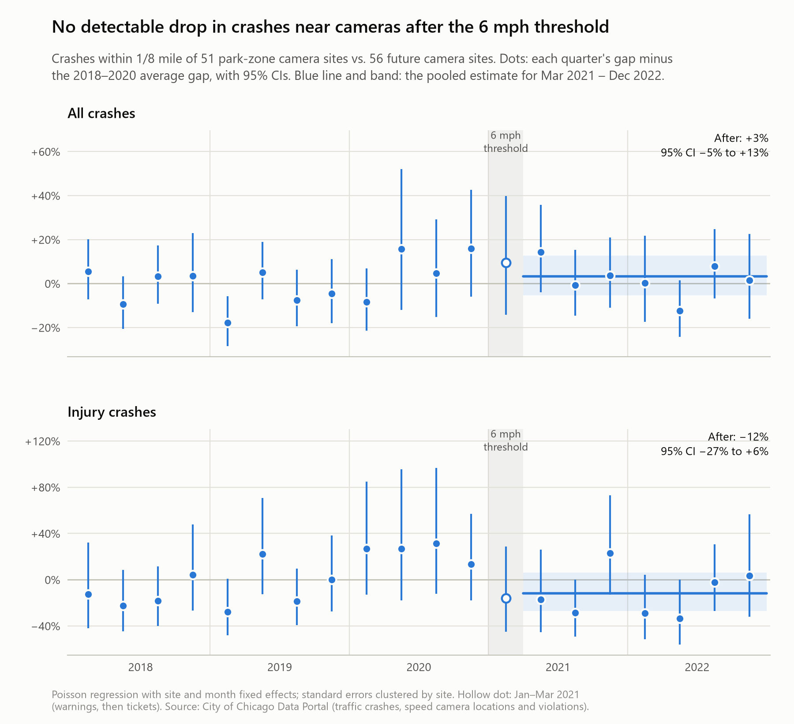
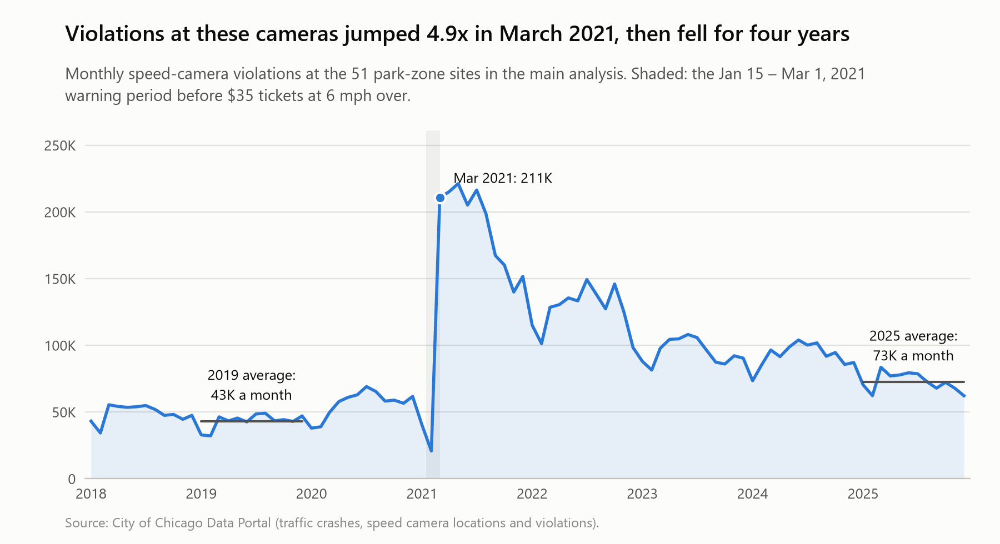
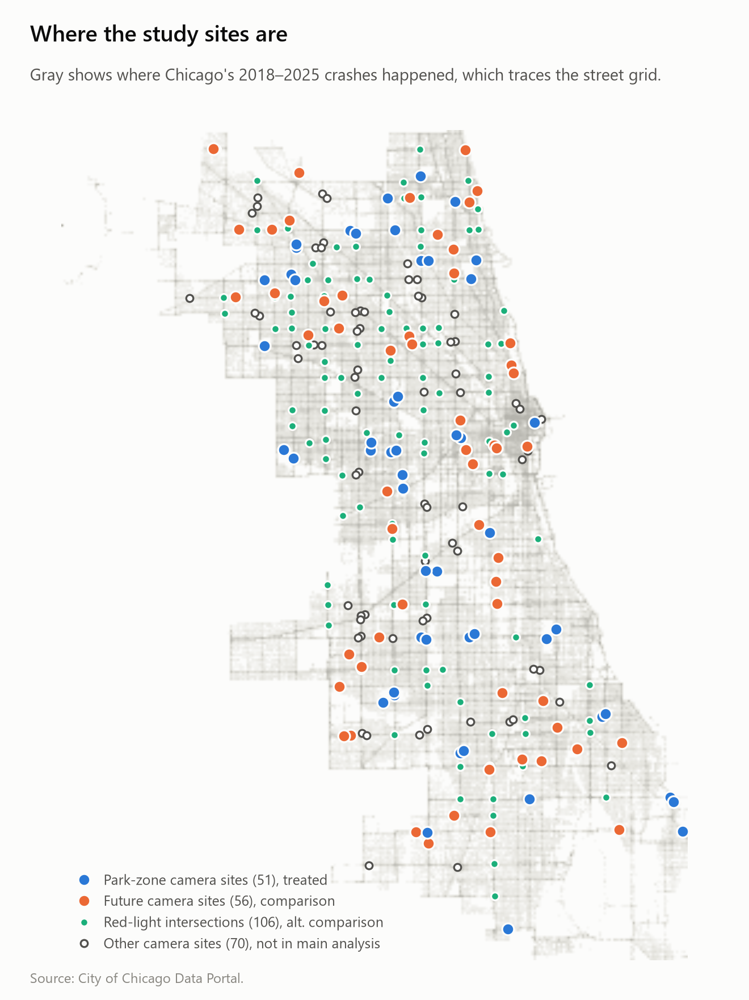
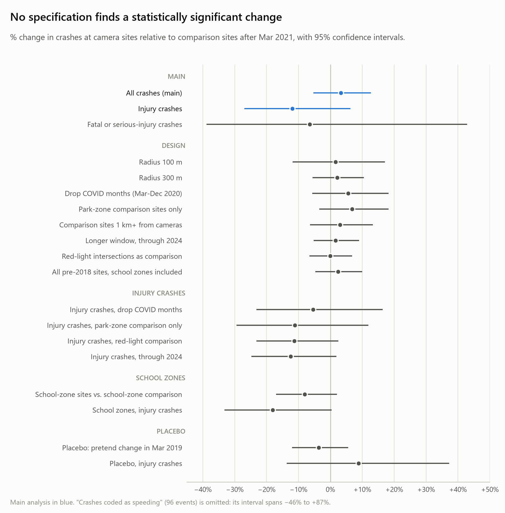
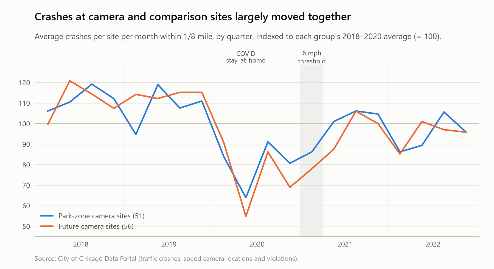

# Did Chicago's 6 mph speed-camera threshold reduce crashes?

On March 1, 2021, Chicago's speed cameras began ticketing drivers going 6 mph over the limit ($35). Until then, they had only ticketed drivers going roughly 10 mph or more over. Supporters framed the change as a safety measure; critics called it a revenue grab. In the month tickets began, violations at the same cameras reached almost five times their 2019 level.

This project asks whether crashes near those cameras fell, compared with similar places that had no camera.

**Short answer: no detectable reduction.** Compared with sites that got cameras only later, total crashes within 1/8 mile of the affected cameras changed by **+3% (95% CI −5% to +13%)**. That rules out a drop larger than about 5%. Injury crashes fell **12%** relative to comparison sites, but that interval (−27% to +6%) includes zero, and the estimate shrinks to −5% when March–December 2020 is excluded. Fatal and serious-injury crashes are too rare at this scale to evaluate.

<picture>
  <source media="(prefers-color-scheme: dark)" srcset="output/figures/event_study-dark.png">
  
</picture>

## Findings

1. **The policy changed enforcement a lot.** At the 51 study sites (65 cameras), violations went from about 43,000 a month in 2019 to 211,000 in March 2021. By 2025 they had fallen to 73,000 a month. That decline fits drivers slowing down near cameras, though less traffic or camera downtime could also contribute.
2. **Total crashes didn't fall relative to comparison sites:** +3.3% (95% CI −5.3% to +12.7%). Eight alternative designs give estimates from −0.1% to +6.8%, and none is statistically significant. A fake policy date of March 2019 finds nothing (−3.6%), as it should.
3. **Injury crashes:** −11.9% (95% CI −27.0% to +6.3%). All five injury specifications are negative (−5% to −12.5%), but none is significant at the 5% level, and the estimate is weakest when COVID months are dropped. This is suggestive, not conclusive.
4. **Fatal or serious-injury crashes:** −6.5% (95% CI −39% to +43%). With 311 such crashes in the sample, there isn't enough data to say anything.

<picture>
  <source media="(prefers-color-scheme: dark)" srcset="output/figures/violations-dark.png">
  
</picture>

## Design

**What is being compared.** The question is about the threshold, not about cameras in general. Comparing camera sites with the rest of the city would mostly capture whatever makes camera locations different in the first place. So this is a difference-in-differences: did crashes near cameras that had already operated for years *change* after March 2021, relative to the change at comparable sites?

**Comparison group: places the city later chose for cameras.** 73 cameras went live from 2023 to 2026. The same program picked their locations for the same reasons (near parks and schools, crash history), but none had a camera in 2021. After dropping any location within 500 m of a camera that operated during 2018–2022, 56 sites remain. As a second, independent comparison, 106 red-light-camera intersections at least 500 m from any speed camera that operated in 2018–2022 serve the same role.

**Model.** Poisson regression of monthly crash counts on site fixed effects, month fixed effects, and a treated × post indicator, with standard errors clustered by site. Site effects absorb permanent differences between places (traffic volume, road design). Month effects absorb citywide shocks (COVID, weather, reporting changes). The coefficient is read as a percent change: 100 × (e^β − 1). January and February 2021 are excluded because warning notices began on January 15. Crashes are counted within 1/8 mile (201 m), the radius CDOT uses in its own camera evaluations, and each crash is assigned to its nearest camera so overlapping buffers never double-count.

**Data.** City of Chicago open data portal: 877,921 police-reported crashes (2018–2025), speed camera locations, 505,376 camera-days of violations, and red-light camera locations. As a check, the violations data show 326,083 violations from 138 cameras in March 2021, which matches the figures [the city reported at the time](https://www.cbsnews.com/amp/chicago/news/chicagos-speed-cameras-churn-out-hundreds-of-thousands-of-tickets-after-rule-change).

<picture>
  <source media="(prefers-color-scheme: dark)" srcset="output/figures/map-dark.png">
  
</picture>

## Three things the data forced me to get right

None of these were in the original plan. Each came from checking the data before trusting a model.

**1. School-zone cameras went dark during remote learning.** School-zone cameras enforce only on school days; park-zone cameras run every day. I classified each camera by the share of its violations that fall on weekends, and the split is clean: exactly 0% for every school-zone camera, at least 24.9% for every park-zone camera. School-zone cameras logged almost no violations from spring 2020 until they came back between January and May 2021. That's the same window as the threshold change, so at those sites the threshold can't be separated from enforcement resuming and students returning. The main analysis uses only park-zone sites whose cameras logged violations in nearly every month of 2018–2022. Pooling all sites would have nearly failed the pre-trend test (p = 0.05).

**2. Retired cameras still count.** The city's camera-location file lists current cameras only. 27 more cameras appear in the violation records, and most of those operated until sometime between 2021 and 2024. Without them, several "future camera" sites would have had a camera nearby, or at the same spot, the whole time. They are included in every distance check, and a site leaves the panel just before any camera within 500 m of it starts or stops.

**3. 2020 is a bad baseline.** COVID cut crashes sharply and unevenly in 2020. Any single quarter makes a noisy zero point, so the event study measures each quarter against the 2018–2020 average gap, the same baseline the pooled estimate uses. Every headline result is also re-run without March–December 2020.

## Robustness

<picture>
  <source media="(prefers-color-scheme: dark)" srcset="output/figures/robustness-dark.png">
  
</picture>

| Block | Specification | Change | 95% CI | p | Sites (treated / comparison) | Crashes |
|---|---|---:|---:|---:|---:|---:|
| Main | **All crashes (main)** | **+3.3%** | −5.3% to +12.7% | 0.46 | 51 / 56 | 17,395 |
| Main | **Injury crashes** | **−11.9%** | −27.0% to +6.3% | 0.19 | 50 / 56 | 2,582 |
| Main | Fatal or serious-injury crashes | −6.5% | −38.8% to +42.9% | 0.76 | 44 / 49 | 311 |
| Main | Crashes coded as speeding | +0.6% | −46.0% to +87.4% | 0.99 | 25 / 31 | 96 |
| Design | Radius 100 m | +1.6% | −11.8% to +17.1% | 0.82 | 51 / 56 | 6,235 |
| Design | Radius 300 m | +2.2% | −5.6% to +10.5% | 0.59 | 51 / 56 | 34,541 |
| Design | Drop COVID months (Mar–Dec 2020) | +5.6% | −5.7% to +18.3% | 0.35 | 51 / 56 | 15,177 |
| Design | Park-zone comparison sites only | +6.8% | −3.5% to +18.3% | 0.20 | 51 / 38 | 14,183 |
| Design | Comparison sites 1 km+ from cameras | +3.0% | −6.4% to +13.3% | 0.54 | 51 / 38 | 14,410 |
| Design | Longer window, through 2024 | +1.6% | −5.3% to +9.0% | 0.65 | 51 / 56 | 23,198 |
| Design | Red-light intersections as comparison | −0.1% | −6.5% to +6.8% | 0.98 | 51 / 106 | 62,699 |
| Design | All pre-2018 sites, school zones included | +2.4% | −4.7% to +10.0% | 0.52 | 102 / 56 | 29,065 |
| Injury | Injury crashes, drop COVID months | −5.4% | −23.2% to +16.4% | 0.60 | 50 / 56 | 2,204 |
| Injury | Injury crashes, park-zone comparison only | −11.1% | −29.4% to +11.9% | 0.32 | 50 / 38 | 2,074 |
| Injury | Injury crashes, red-light comparison | −11.3% | −23.2% to +2.5% | 0.10 | 50 / 106 | 9,628 |
| Injury | Injury crashes, through 2024 | −12.5% | −24.8% to +1.9% | 0.09 | 50 / 56 | 3,504 |
| School zones | School-zone sites vs. school-zone comparison | −8.0% | −17.1% to +2.0% | 0.11 | 41 / 17 | 9,682 |
| School zones | School zones, injury crashes | −18.1% | −33.2% to +0.4% | 0.05 | 41 / 17 | 1,395 |
| Placebo | Pretend change in Mar 2019 | −3.6% | −12.0% to +5.6% | 0.43 | 51 / 56 | 8,732 |
| Placebo | Pretend change in Mar 2019, injury crashes | +8.9% | −13.6% to +37.3% | 0.47 | 48 / 56 | 1,230 |

**Parallel trends.** A joint test that every pre-2021 quarter shows the same treated–comparison gap gives p = 0.11 for the main specification, 0.20 for injury crashes, and 0.81 with red-light intersections as the comparison. Without any model, average crashes per site per month went from 2.70 to 2.65 at camera sites (−1.7%) and from 2.98 to 2.84 at comparison sites (−4.6%), a ratio of +3.0%, matching the Poisson estimate.

<picture>
  <source media="(prefers-color-scheme: dark)" srcset="output/figures/raw_trends-dark.png">
  
</picture>

## Limitations

- **Most crashes near a camera aren't speeding crashes.** The 1/8-mile buffer includes intersections where rear-ends, turns, and parking crashes dominate. A real effect on the crashes that 6–10 mph speeding causes could be diluted. Police rarely code speeding as a cause (96 crashes in the sample), so those crashes can't be isolated.
- **Too few severe crashes.** The design rules out large changes in total crashes, but not in fatal or serious-injury crashes.
- **The comparison sites were chosen later.** If the city picked 2023+ locations because crashes there rose in 2021–22, comparison sites would look worse after 2021, which would bias the estimate toward finding a benefit. The red-light comparison, chosen long before, gives the same answer (−0.1%), but this can't be ruled out completely.
- **Spillovers.** If the change slowed drivers across the whole city, comparison sites would benefit too, and the estimate would understate the effect. Comparison sites more than 1 km from any camera give the same result (+3.0%), which argues against local spillovers but not against citywide ones.
- **School zones remain open.** Skipping the closure period (Mar 2020 – Aug 2021) gives −8% for all crashes and −18% for injury crashes at school-zone sites. That design fails its pre-trend test (p = 0.01), so I don't treat it as evidence.
- **Not measured here:** speeds themselves (per-camera speed distributions aren't public), pedestrian and cyclist outcomes specifically, or who pays the tickets.

## How this fits with earlier work

CDOT's own evaluations compare periods years apart around installation; one found fatal and serious-injury crashes near cameras rose 2% from 2012–13 to 2018–19, versus 21% citywide ([Streetsblog Chicago](https://chi.streetsblog.org/2022/01/06/bakery-fresh-new-cdot-study-reaffirms-speed-cameras-are-saving-lives)). A UIC study of 2015–2017 data found cameras reduced fatal and serious crashes by about 15% ([CBS Chicago](https://www.cbsnews.com/chicago/news/uic-study-speed-cameras-safety-tickets-relationship)). Both study whether *cameras* work, and both predate the 2021 change. A 2022 [Axios analysis](https://www.axios.com/local/chicago/2022/07/19/speed-camera-data-offers-mixed-picture) compared raw changes in fatal crashes near and away from cameras over a short window. This project isolates the threshold itself. The results don't conflict with cameras reducing crashes. They suggest that extending tickets to the 6–10 mph range didn't produce a further measurable drop in total crashes nearby.

## Next steps

- **The 2025 expansion as its own experiment.** About 50 cameras went live in mid-to-late 2025 on a staggered schedule, which is a clean setup for a staggered difference-in-differences (Callaway–Sant'Anna) on the effect of *installing* a camera.
- **Pedestrian and cyclist crashes,** using the city's crash-people table.
- **The mechanism.** A FOIA request for per-camera speed distributions would show whether speeds actually fell, and by how much.

## Reproduce

Built with Python 3.14. The first run downloads about 880,000 crash records (about 130 MB, a few minutes), which are cached after that.

```powershell
python -m venv .venv
.venv\Scripts\python -m pip install -r requirements.txt
.venv\Scripts\python run_all.py
```

On macOS or Linux, use `.venv/bin/python` instead. The data were downloaded on November 20, 2026 (see `data/raw/MANIFEST.json` after a run). The portal amends crash records over time, so a fresh download can shift results slightly.

```
src/config.py     every analytic choice in one place (dates, radii, distances, groups)
src/download.py   step 1: pull data from the Chicago open data portal (cached)
src/sites.py      step 2: camera universe incl. retired cameras, sites, study groups
src/panel.py      step 3: crashes per site per month at three radii; violations per month
src/estimate.py   step 4: Poisson DiD, event studies, every specification above
src/figures.py    step 5: figures, light and dark
data/processed/   derived site list, camera list, panel (small; committed)
output/           result tables (CSV/JSON) and figures
```

## Sources

- Data: [Traffic Crashes – Crashes](https://data.cityofchicago.org/d/85ca-t3if), [Speed Camera Locations](https://data.cityofchicago.org/d/4i42-qv3h), [Speed Camera Violations](https://data.cityofchicago.org/d/hhkd-xvj4), [Red Light Camera Locations](https://data.cityofchicago.org/d/thvf-6diy), City of Chicago Data Portal.
- Policy timeline: [warnings from Jan 15, 2021](https://chi.streetsblog.org/2021/01/21/city-is-now-issuing-warnings-for-6-mph-speed-cam-violations-35-tickets-after-march-1); [tickets from Mar 1, 2021](https://cbsnews.com/chicago/news/city-to-begin-enforcing-new-lower-threshold-for-speed-camera-tickets-on-march-1-after-44-day-grace-period).
